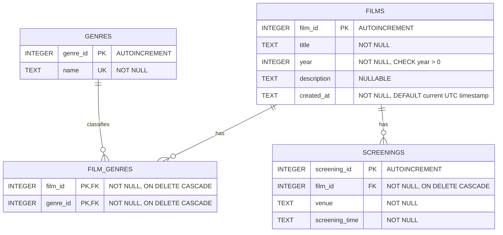

# Entity Relationship Diagram

The diagram below represents the database schema used by Marquee.

## Relationships

- **Films and Genres:** Many-to-many relationship implemented through the `film_genres` junction table.
- **Films and Screenings:** One-to-many relationship. A film can have multiple screenings, while each screening belongs to one film.

## Database Constraints

- All primary keys use SQLite `INTEGER PRIMARY KEY AUTOINCREMENT`.
- Genre names must be unique.
- Film years must be greater than zero.
- Required columns are declared `NOT NULL`.
- Deleting a film cascades to its associated genre links and screenings.
- Deleting a genre cascades to its associated film links.
- Foreign-key enforcement is enabled on every database connection.

## Indexes

The schema defines the following indexes:

| Index | Table | Column | Purpose |
|---|---|---|---|
| `idx_film_genres_genre` | `film_genres` | `genre_id` | Speeds up genre filtering and cascading deletions |
| `idx_screenings_film` | `screenings` | `film_id` | Speeds up film-based screening queries |
| `idx_screenings_venue` | `screenings` | `venue` | Speeds up venue filtering |
| `idx_screenings_time` | `screenings` | `screening_time` | Speeds up screening-time queries |
